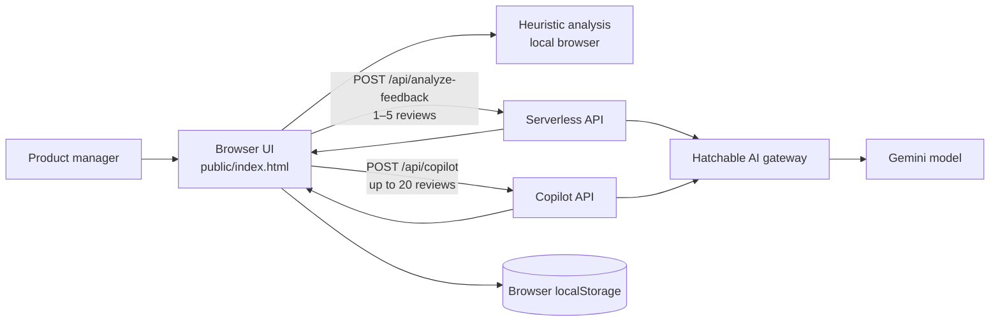

# OrderLens AI — Architecture

## Request flow

1. The browser imports a CSV and performs baseline heuristic analysis locally.
2. AI Review sends a small batch of review text to `/api/analyze-feedback`.
3. Copilot sends a question plus a bounded sample of feedback to `/api/copilot`.
4. The server-side handlers call the Hatchable AI gateway and normalize model output before returning it.
5. The browser displays the response and may persist classifications in local storage.

## Trust and operational boundaries

- The API key belongs in Hatchable's server-side secret settings; it must never be embedded in frontend code or committed.
- Review text is sent to the hosted AI provider when AI features are used. Use synthetic/demo feedback for public demos and avoid unapproved sensitive data.
- Copilot receives a representative sample, not necessarily the full dataset. Its answers are advisory, not ground truth.
- The app has no shared durable database or authentication layer in this prototype. Browser persistence is device/browser-local.
- The health endpoint is a lightweight route check; it does not prove the AI provider or secret is configured correctly.
- GitHub Actions validates handler behavior with a mocked AI gateway. It does not call Gemini or verify production secrets.
